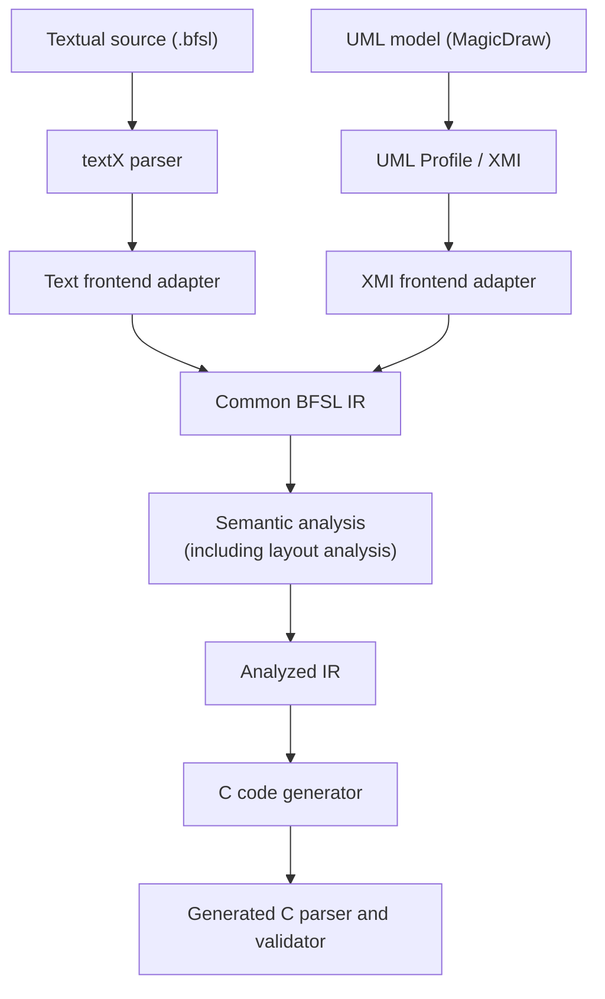
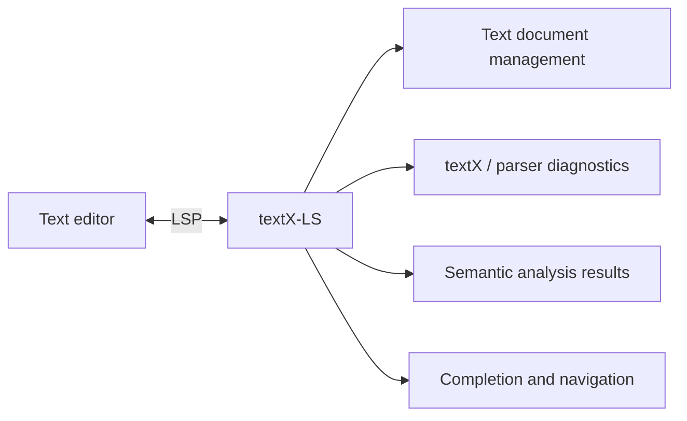

# BFSL - Binary Format Specification Language

## Contents

1. [Project overview](#1-project-overview)
2. [Domain and motivation](#2-domain-and-motivation)
3. [Goals and scope](#3-goals-and-scope)
4. [Proposed architecture](#4-proposed-architecture)
5. [Language design](#5-language-design)
6. [Textual frontend and editor support](#6-textual-frontend-and-editor-support)
7. [UML frontend and model-driven engineering](#7-uml-frontend-and-model-driven-engineering)
8. [Intermediate representation and analysis](#8-intermediate-representation-and-analysis)
9. [Code generation](#9-code-generation)
10. [Testing and evaluation](#10-testing-and-evaluation)
11. [CLI and packaging](#11-cli-and-packaging)
12. [Team organization and work distribution](#12-team-organization-and-work-distribution)
13. [Development plan](#13-development-plan)
14. [References](#references)

## 1. Project overview

BFSL (Binary Format Specification Language) is a declarative language for describing binary data formats. A developer specifies fields, types, byte order, layout rules, and validation constraints. BFSL then analyzes the specification and generates C code implementing a parser and validator for the described format.

The project will provide two specification frontends:

1. A textual DSL, implemented using textX and stored in `.bfsl` files.
2. A graphical UML frontend, implemented through a UML Profile in MagicDraw and an XMI adapter.

Both frontends will be translated into a common, frontend-independent intermediate representation (IR). Semantic analysis, layout analysis, and code generation will operate on that shared representation. The toolchain will also provide Language Server Protocol (LSP) support for the textual language, integrating language-aware features into a code editor [2].

The initial implementation will focus on generating C parsers and validators. The architecture will allow additional code-generation targets in the future, but multiple generated languages are not in initial project scope.

## 2. Domain and motivation

Binary formats are used throughout software systems: disk structures, executable files, images, network protocols, and many other forms of structured data. Their definitions often involve fixed-width fields, byte order, nested structures, conditional fields, variable-length regions, checksums, and constraints between fields.

Implementing parsers for these formats directly in a general-purpose language can lead to duplicated low-level code and make the relationship between a format specification and its parser difficult to inspect [11]. A declarative specification can make the layout and validation rules explicit and provide a single source from which parser code and editor feedback are generated.

BFSL addresses this problem by combining:

- a textual language for describing binary formats;
- a UML-based graphical representation of the same concepts;
- semantic and layout analysis before code generation;
- generated C parsing and validation code;
- editor support through LSP.

The project is relevant to both model-driven engineering and compiler/toolchain construction. Model-driven engineering treats models, metamodels, modeling languages, and transformations as central development concepts [4]. The UML frontend provides a model-based way to author specifications, while the shared IR acts as the common model used by analysis and generation. Model transformations are a core MDE activity, including transformations between models and transformations from models to implementation artifacts [5].

### 2.1. Existing solutions and project positioning

Several existing tools address the declarative description and parsing of binary formats. The most directly related solution is Kaitai Struct, a domain-specific language for describing binary data structures. Kaitai specifications are written in `.ksy` files and compiled into parsers for multiple programming languages. The project provides a Web IDE, visualizer, runtime libraries, and a collection of format specifications [12].

Another related approach is Construct, a Python library for declarative binary parsing and building. It supports structures, arrays, bit-level operations, conditional constructs, and context-dependent field sizes. Unlike BFSL, Construct is primarily a Python library whose descriptions are used directly for parsing and building, rather than a separate language and compiler that generates C source code [13].

BFSL is not intended to replace mature solutions such as Kaitai Struct or Construct, nor to provide broader binary-format coverage. Its primary focus is demonstrating a model-driven development workflow that combines multiple modeling approaches within one toolchain. Its main distinguishing characteristics are a custom UML Profile frontend alongside a textual DSL, a shared frontend-independent intermediate representation, explicit semantic and layout analysis, and code generation targeting standard C. The project will also explore integration with a conventional code editor through LSP support for the textual language.

## 3. Goals and scope

### 3.1. Main goals

The initial version aims to:

- Define a usable declarative language for a representative subset of binary formats.
- Support textual specifications using textX.
- Support equivalent UML specifications using a MagicDraw UML Profile.
- Transform both frontends into the same IR.
- Perform name resolution, type and expression checks, semantic validation, and static layout analysis.
- Generate C parsers and validators from analyzed specifications.
- Provide LSP-based editor support for the textual language.
- Package the implementation as an installable Python project with a CLI.

### 3.2. Initial language scope

The initial language scope includes:

- Fixed-width signed and unsigned integer types and raw byte sequences.
- `const`, `enum`, `bitfield`, `struct`, `union`, and `format` declarations.
- Fixed-storage bitfield types using one `u8`, `u16`, `u32`, or `u64` storage unit, `bits[N]` members whose widths fill that unit, and explicit `msb_first` or `lsb_first` ordering.
- Arrays with a constant length, a length based on previously parsed fields, or repetition `while` or `until` a condition.
- Size-bounded fields (`size`), which let a length field control the extent of a nested structure, union, or array.
- `little` and `big` endianness, with context inheritance and local overrides.
- `expect` and `where` field constraints.
- Conditional fields using `if`.
- Union alternative selection using `switch`.
- Cross-field `validate` blocks.
- Compile-time `assert` checks, including `size_of` and `offset_of` where statically determinable.
- Explicit padding.
- One precisely defined CRC-32 variant for checksum validation.
- `bytes[$remaining]` for consuming the remaining bytes in the current bounded parsing region.
- Built-in helper functions (for example `hex`, `ascii`, `zeros`, `len`, `present`).

### 3.3. Initial tooling scope

The initial toolchain includes:

- Textual frontend and textX grammar.
- UML Profile and XMI-to-IR adapter.
- Common IR, semantic analysis, and layout analysis.
- C parser and validator generator.
- A small runtime support component where needed by generated C code, including checksum support.
- CLI commands for checking specifications and generating C code.
- LSP support for the textual language.

## 4. Proposed architecture

The toolchain is organized around two frontends and one shared processing pipeline:



The textual language also connects to an LSP server:



The LSP server will reuse the language frontend and analysis components. It should not maintain a separate interpretation of the language.

The main architectural principle is that frontend-specific models are converted into a shared IR before semantic analysis, which includes layout analysis. The code generator must consume the analyzed IR, not the internal model produced by textX or the UML tool.

## 5. Language design

The language is designed to describe structure and validation declaratively. Its main declarations are `const`, `enum`, `bitfield`, `struct`, `union`, and `format`. Only `format` declarations are parsing entry points: structures are helper types used by formats, and formats cannot be nested.

A simplified example:

```rust
enum MessageKind: u8 {
    TEXT = 1;
    BINARY = 2;
}

bitfield MessageFlags: u8 {
    bit_order msb_first;
    compressed: bits[1];
    reserved: bits[7] expect 0;
}

struct TextPayload {
    encoding: u8;
    content: bytes[$remaining];
}

struct BinaryPayload {
    content: bytes[$remaining];
}

struct UnknownPayload {
    content: bytes[$remaining];
}

union Payload {
    text: TextPayload;
    binary: BinaryPayload;
    unknown: UnknownPayload;
}

format Message {
    endian big;
    magic: bytes[2] expect hex("BF 01");
    kind: MessageKind;
    flags: MessageFlags;

    payload: Payload switch kind {
        TEXT => text;
        BINARY => binary;
        default => unknown;
    };
}
```

Top-level constants can be used in field constraints and array lengths to avoid repeated numeric literals. The complete proposed syntax, examples, constraints, semantic rules, and still-open design decisions are documented separately in [`docs/language-design.md`](docs/language-design.md).

## 6. Textual frontend and editor support

The textual frontend will be implemented using textX [1]. Its editor support will reuse the existing textX-LS language server rather than implementing a separate LSP server from scratch.

The BFSL language will be registered as a textX language project, and the corresponding Visual Studio Code extension and syntax-highlighting configuration will be generated using the available textX tooling [3].

The initial editor support will include:

- Syntax highlighting for `.bfsl` files.
- Syntax and textX model diagnostics.
- Code completion.
- Go-to-definition and find references.
- Code folding and document symbol outline [3].

BFSL-specific semantic and layout diagnostics will be integrated with the results of the common IR analysis. The integration will preserve source locations so that diagnostics and navigation features can refer to the corresponding positions in the original BFSL document.

## 7. UML frontend and model-driven engineering

The graphical frontend will be implemented using a UML Profile in MagicDraw. The profile will extend UML metaclasses with BFSL-specific stereotypes and tagged values [6].

The initial profile is expected to include:

| Stereotype | UML metaclass | Purpose |
|---|---|---|
| `BFSLFormat` | Class | Top-level binary format. |
| `BFSLStruct` | Class | Composite structure. |
| `BFSLUnion` | Class | Alternative interpretations of a data region. |
| `BFSLBitfield` | Class | Fixed-width storage unit divided into bit members. |
| `BFSLEnum` | Enumeration | Integer-based enumeration. |
| `BFSLField` | Property | Field in a structure or format. |
| `BFSLPadding` | Property | Explicit padding. |
| `BFSLChecksum` | Property | Checksum field. |
| `BFSLValidation` | Constraint | Runtime validation expression. |
| `BFSLAssertion` | Constraint | Compile-time layout assertion. |

Tagged values will describe properties such as endianness, array lengths, expected values, field conditions, switch mappings, enum openness, and checksum configuration.

An XMI adapter will read the UML model and translate it into the same common IR used by the textX frontend. This ensures that semantic analysis, layout analysis, and code generation are shared between the two authoring approaches.

The textual and UML frontends should be able to represent equivalent specifications. This will be demonstrated by creating at least one example in both frontends and comparing the resulting analyzed IR and generated behavior.

## 8. Intermediate representation and analysis

The common IR is the central, frontend-independent model of BFSL. It will contain normalized declarations, types, constants, fields, resolved references, expressions, constraints, switch mappings, and format information.

The IR is deliberately separate from both the textX model and the UML/XMI model. This separation prevents the semantic implementation and code generator from becoming dependent on a particular frontend.

Semantic analysis runs as two main passes over the IR:

1. Name and type analysis resolves names and references, checks type compatibility, verifies expressions and constant values, validates field and modifier combinations, and reports invalid declarations.

2. Layout analysis, the final pass, calculates field sizes and offsets when possible, determines bounded parsing regions, detects layouts that cannot be statically resolved, and evaluates compile-time assertions such as `size_of` and `offset_of`.

The analyzed IR will carry the information needed by the C generator, including resolved types, field offsets and sizes where available, endian context, runtime validation rules, and source references for diagnostics.

## 9. Code generation

The initial backend will generate C parser and validator code from the analyzed IR. The generator itself will be implemented in Python as part of the BFSL toolchain and will emit C source and header files. Whether the implementation uses a template engine or a structured code-emission layer will be decided during implementation; in either case, generation will operate on the analyzed IR.

The generated parser is expected to:

- Read fields in specification order.
- Interpret integer fields using the specified endianness.
- Read bitfield storage units with explicit byte-order handling and extract named members using portable masks and shifts.
- Handle fixed-size arrays and supported field-dependent lengths.
- Evaluate conditional fields and switch-selected union alternatives.
- Check expected values and field-level constraints.
- Evaluate cross-field validation expressions.
- Verify supported checksum fields.
- Report parsing or validation failures through a consistent result/error interface.

The generated code should be accompanied by a small runtime support component where common operations are needed, such as safe byte reads, bounds checks, and the selected CRC-32 implementation. The generator should not emit C bit-field declarations for parsed data because their layout is implementation-defined; it should emit ordinary integer fields populated from explicitly decoded storage values [7]. The generated parser must not rely on unaligned pointer casts or host-native byte order when interpreting input.

The initial backend targets C only. The common IR should not assume C-specific semantics, so additional targets such as Python can be considered later without redesigning the frontends and semantic pipeline.

## 10. Testing and evaluation

The implementation will be validated through unit, integration, and end-to-end tests.

The evaluation will focus on the following aspects:

- Language correctness: Valid specifications must be parsed and analyzed successfully, while invalid declarations, unresolved references, incompatible types, and invalid layouts must produce diagnostics.
- Generated code correctness: Generated C parsers must compile and correctly process valid binary fixtures. Invalid inputs, including truncated data, incorrect field values, invalid lengths, and checksum mismatches, must be rejected.
- Format coverage: The implementation will be demonstrated using representative MBR, TCP base-header, and PNG chunk specifications.
- Frontend equivalence: Specifications represented in both the textual DSL and UML must produce equivalent normalized IR and equivalent parser behavior.
- Editor integration: The supported LSP features and source locations of language diagnostics will be tested in Visual Studio Code.
- Distribution: The Python package must be installable from a built wheel, and the CLI must work in a clean environment.

For generated C code, tests will also verify safe input-boundary handling and the absence of undefined behavior in the supported parsing operations.

## 11. CLI and packaging

The implementation will be distributed as an installable Python package. The repository will include a `pyproject.toml`, dependency declarations, package metadata, and instructions for building and installing a wheel.

The proposed command-line interface is `bfsl`. The initial commands are expected to cover:

```text
bfsl check path/to/specification.bfsl
bfsl generate path/to/specification.bfsl --target c --output build/
```

The exact command syntax can be finalized during implementation. The CLI should expose the same parsing and analysis pipeline used by the LSP server and code generator rather than duplicate the compiler workflow.

The textX language registration and generator registration mechanisms will be configured where applicable. The README will document installation, usage, editor setup, generated output, and a minimal end-to-end example.

## 12. Team organization and work distribution

The project combines the requirements of the Domain-Specific Languages and Rapid Software Development Methodologies courses. Each team member owns a major subsystem while contributing to both the language implementation and the model-driven development workflow.

| Member | Primary responsibility | Contribution to Domain-Specific Languages | Contribution to Rapid Software Development Methodologies |
|---|---|---|---|
| Member 1 - Layout analysis and C backend | Binary layout analysis and code generation | Layout calculation; byte and bit offset calculation; C parser and validator generation. | Model-to-text transformation from the analyzed BFSL model to C code, including code-generation rules and validation of generated output. |
| Member 2 - Textual frontend and editor support | BFSL textual language and editor integration | textX grammar, textual model conversion, textX-LS configuration, syntax highlighting, completion and language diagnostics. | Model-to-model transformation from the textX model to the common platform-independent BFSL model (IR), including source mapping and frontend integration. |
| Member 3 - Common IR and semantic analysis | Language semantics and common model representation | Symbol and type resolution, constant and expression analysis, validation of constraints, enum values and switch mappings. | Definition of the common platform-independent model (IR), its structural constraints and the contracts shared by both frontends and the code generator. |
| Member 4 - UML frontend and MDE integration | UML-based specification and model transformation | Mapping BFSL language constructs to the common IR and verifying that UML-based specifications preserve the semantics of the textual language. | MagicDraw UML Profile, stereotypes and tagged values, XMI processing, UML-to-IR model transformation and frontend equivalence testing. |

The responsibilities are organized around shared architectural components rather than separate implementations for the two courses. The same IR and transformation pipeline serve both the textual DSL and the UML-based modeling approach. All members will contribute to integration testing, documentation and the final demonstration. Layout analysis is the final pass of semantic analysis: Member 1 implements it on top of the symbol and type resolution provided by Member 3.

## 13. Development plan

The work will be tracked using GitHub Issues and a GitHub Projects Kanban board.

### Milestone 1 - Frontends and language analysis

- Implement the textX grammar and the textX-model-to-IR adapter.
- Implement the common IR and its validation invariants.
- Implement name and symbol resolution, type checking, constant evaluation, and expression analysis.
- Implement semantic checks for field constraints, enum declarations, `switch` mappings, modifier combinations, and fixed-storage bitfield widths.
- Implement static layout analysis for supported constructs, including byte sizes/offsets, fixed bitfield storage layout and member bit positions, padding, and compile-time assertions where values are statically determinable.
- Create the MagicDraw UML Profile and XMI-to-IR adapter for the agreed MVP subset.
- Create equivalent textual and UML versions of at least one representative specification and compare their normalized IR.
- Establish the initial editor integration from textX-LS, including `.bfsl` recognition, syntax highlighting, and syntax/model diagnostics.

### Milestone 2 - Editor integration and C code generation

- Connect BFSL semantic and layout diagnostics to textX-LS/editor feedback, using source locations from the common analysis pipeline.
- Configure and test completion, go-to-definition, and find references for the supported BFSL declarations and references.
- Implement the C generator against the analyzed IR.
- Generate parsers and validators for the agreed MVP constructs, including fixed-width integers, byte sequences, arrays, endianness, supported constraints, fixed-storage bitfields, and the selected conditional/union constructs included in the frozen scope.
- Implement the C runtime support, including bounded reads, cursor/bounds checks, consistent parse errors, and the precisely specified CRC-32 variant.
- Integrate the `bfsl check` and `bfsl generate` CLI commands with the same parsing and analysis pipeline used by editor tooling.

### Milestone 3 - Demonstration, validation, and delivery

- Complete the MBR sector, TCP base-header, and PNG-chunk specifications within the implemented language scope [8–10].
- Add binary fixtures for valid and invalid inputs, including incorrect magic values, invalid lengths, truncated buffers, incorrect bitfield values, and CRC mismatches where applicable.
- Verify equivalent textual and UML behavior on at least one representative non-trivial specification; use additional frontend-equivalence cases if time permits.
- Run end-to-end tests from `.bfsl` source and UML/XMI model through IR analysis to generated C compilation and execution.
- Verify package installation from a built wheel, CLI usage, and editor setup from a clean environment.
- Improve diagnostics, documentation, installation instructions, language examples, and descriptions of unsupported features.
- Prepare the final demonstration and presentation.

## References

1. **Dejanović, I., Vaderna, R., Milosavljević, G., & Vuković, Ž. (2017).** “TextX: A Python tool for Domain-Specific Languages implementation.” *Knowledge-Based Systems*, 115, 1–4. https://doi.org/10.1016/j.knosys.2016.10.023.
2. **Microsoft.** “Language Server Protocol Specification.” https://microsoft.github.io/language-server-protocol/.
3. **textX Project.** “textX-LS: Language server for domain-specific languages based on textX.” https://github.com/textX/textX-LS.
4. **Rodrigues da Silva, A. (2015).** “Model-driven engineering: A survey supported by the unified conceptual model.” *Computer Languages, Systems & Structures*, 43, 139–155. https://doi.org/10.1016/j.cl.2015.06.001.
5. **Jouault, F., Allilaire, F., Bézivin, J., & Kurtev, I. (2008).** “ATL: A model transformation tool.” *Science of Computer Programming*, 72(1–2), 31–39. https://doi.org/10.1016/j.scico.2007.08.002.
6. **Object Management Group (OMG).** “OMG Unified Modeling Language (OMG UML), Version 2.5.1.” https://www.omg.org/spec/UML/2.5.1.
7. **ISO/IEC JTC 1/SC 22/WG 14.** “ISO/IEC 9899:2011 Committee Draft N1570,” §6.7.2.1, paragraph 11. https://www.open-std.org/jtc1/sc22/wg14/www/docs/n1570.pdf.
8. **UEFI Forum.** “UEFI Specification, Version 2.10,” Chapter 5, especially §5.2.1, Legacy Master Boot Record. https://uefi.org/specs/UEFI/2.10/05_GUID_Partition_Table_Format.html.
9. **Eddy, W. (Ed.). (2022).** “RFC 9293: Transmission Control Protocol (TCP).” RFC Editor. https://www.rfc-editor.org/rfc/rfc9293.
10. **W3C. (2025).** “Portable Network Graphics (PNG) Specification, Third Edition.” W3C Recommendation, 24 June 2025. https://www.w3.org/TR/png-3/.
11. **Fisher, K., & Gruber, R. (2005).** “PADS: A Domain-Specific Language for Processing Ad Hoc Data.” *Proceedings of PLDI 2005*, 295–304. https://doi.org/10.1145/1065010.1065046.
12. **Kaitai Project.** “Kaitai Struct User Guide.” Kaitai Struct, version 0.11. https://doc.kaitai.io/user_guide.html.
13. **Construct Project.** “Construct - A Powerful Declarative and Symmetrical Parser and Builder for Binary Data.” Construct 2.10 Documentation. https://construct.readthedocs.io/en/latest/intro.html.
